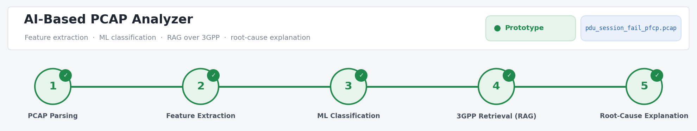

# AI PCAP Analysis

**A Study on AI-Based PCAP Analysis for Anomaly Detection and Performance Optimization in Telecom Networks**

MBA Research Project (Semester IV) — Navaz Chilakala · USN 241VMBR01593 · Jain (Deemed-to-be) University

**Live demo: https://ai-pcap-analysis.vercel.app**

This repository contains the final report, presentation, and a working in-browser demo of the proposed framework: upload a packet capture of 5G / VoLTE signalling and get an automatic anomaly verdict with a root-cause explanation grounded in 3GPP specifications.

## Contents

| Path | What it is |
|---|---|
| [`docs/Final_Report.pdf`](docs/Final_Report.pdf) · [`.docx`](docs/Final_Report.docx) | Final research project report |
| [`docs/Slides.pdf`](docs/Slides.pdf) · [`.pptx`](docs/Slides.pptx) | Presentation (31 slides) |
| [`public/`](public) | The demo web app (`index.html`) and sample captures (`sample_pcaps/`) |
| [`scripts/generate_pcaps.py`](scripts/generate_pcaps.py) | Scapy script that generates the 6 synthetic 5G sample captures |
| [`docs/screenshots/`](docs/screenshots) | Screenshots of the demo |

## The demo

Try it live: **[ai-pcap-analysis.vercel.app](https://ai-pcap-analysis.vercel.app)**

The analyzer runs entirely in the browser (no backend, no install) and executes the pipeline described in the report:

1. **PCAP parsing** — decodes Ethernet / IP / TCP / UDP and the application protocols SIP, PFCP, HTTP/2 SBI and RTP.
2. **Feature extraction** — builds per-flow features (status codes, retransmissions, missing responses, durations).
3. **ML classification** — a 10-estimator Random Forest labels each flow SUCCESS / FAILURE with confidence and feature importance.
4. **RAG retrieval** — the anomaly is matched against an embedded 3GPP corpus (TS 23.501/23.502, TS 29.244, TS 29.500, TS 24.229, TS 33.501).
5. **Root-cause explanation** — a grounded, human-readable diagnosis with a recommended action and MTTR comparison.
6. **Chat interface** — ask questions such as "Why did this PDU session fail?"



### Run it locally

Open `public/index.html` in Chrome or Edge, or serve the folder:

```bash
python -m http.server 8000 --directory public
```

Then pick one of the built-in sample buttons or drop in your own `.pcap` / `.pcapng`.

### Sample captures

| File | Scenario | Expected verdict |
|---|---|---|
| `pdu_session_success.pcap` | 5G PDU Session Establishment (N11 + N7 + N4) | Success |
| `pdu_session_fail_pfcp.pcap` | UPF rejects PFCP with Cause 70 "No resources available" | Failure — N4 reject |
| `sbi_fail_404_pcf.pcap` | PCF returns HTTP/2 404 USER_UNKNOWN on N7 | Failure — N7 policy |
| `sbi_timeout_n4.pcap` | UPF never answers PFCP (3 retransmissions) | Failure — N4 timeout |
| `ue_registration_fail_auth.pcap` | AUSF rejects 5G-AKA confirmation (403) on N12 | Failure — auth reject |
| `volte_call_486_busy.pcap` | VoLTE INVITE answered with 486 Busy Here | Failure — user busy |
| `sip_call_success_g711.pcap` | Public Wireshark sample — complete SIP call + RTP | Success |
| `sip_call_aaa.pcap` | Public Wireshark sample — SIP dialogs incl. failures | Failure — SIP 408 |

To regenerate the six synthetic captures: `pip install scapy && python scripts/generate_pcaps.py`.

## Scope note

This is a **simulation prototype for academic demonstration**. PCAP parsing, protocol decoding, flow feature extraction and 3GPP clause grounding are computed live from the uploaded file, but the Random Forest decision logic and RAG retrieval run in simplified in-browser form. The full design in the report uses scikit-learn, ChromaDB and an LLM, plus an unsupervised layer (Isolation Forest / One-Class SVM) as a safety net for unknown anomalies. Model metrics shown on screen are the Random Forest row of Report Table 18.

## Deployment

The site is static; Vercel serves the `public/` folder (see [`vercel.json`](vercel.json)).
